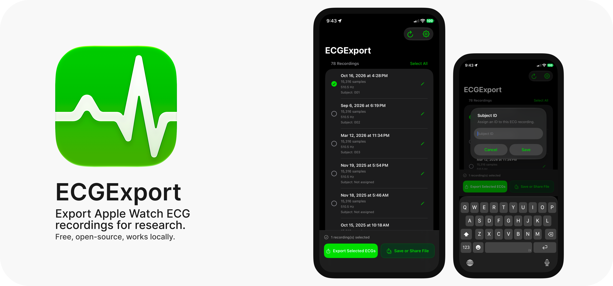

# ECGExport

**Export your Apple Watch ECG recordings as numerical data.**

ECGExport is a free, open-source iOS application that allows you to retrieve previously recorded Apple Watch electrocardiograms (ECGs) from Apple Health and export their waveform data for further analysis.

Built with **SwiftUI** and **Apple HealthKit**, the app provides a straightforward way to access ECG voltage measurements and timestamps without digitizing PDF reports or relying on external services.

Whether you're exploring your own ECG recordings or working with physiological signals for research, ECGExport helps you take your data into your own hands.

---

## Features

- **Access existing ECG recordings** — Retrieve ECG recordings stored in Apple Health using HealthKit.
- **Selective export** — Choose individual recordings, multiple recordings, or your entire available ECG history.
- **Numerical waveform data** — Export ECG voltage measurements in millivolts (mV), alongside their relative timestamps in seconds.
- **Flexible export formats** — Export recordings as a combined CSV file or individual CSV files packaged in a ZIP archive.
- **Subject identification** — Assign custom subject IDs to recordings to organize data from different participants.
- **Recording metadata** — Preserve recording dates and sampling frequencies.
- **Bilingual interface** — Available in English and Turkish.
- **Privacy-focused** — All ECG extraction and file generation take place locally on device.
- **No accounts or subscriptions** — No registration, analytics, advertisements, or external processing servers.

## How It Works

Apple Watch ECG recordings contain numerical voltage measurements that can be accessed through Apple's HealthKit framework.

Although Apple Health provides PDF reports of ECG recordings, these reports are intended primarily for viewing and sharing. ECGExport accesses the underlying waveform measurements directly through HealthKit.

The export process follows five steps:

## Exported Data

ECGExport preserves the individual measurements returned by HealthKit without applying additional signal filtering, normalization, or resampling.

### CSV Structure

Each exported CSV contains the following columns:

| Column | Description | Unit |
|---|---|---|
| `subject_id` | User-assigned subject identifier | — |
| `recording_id` | Unique HealthKit recording identifier | UUID |
| `recording_date` | Date and time of the recording | ISO 8601 |
| `sampling_frequency_hz` | Recorded sampling frequency | Hz |
| `time_s` | Time relative to the beginning of the recording | s |
| `voltage_mV` | ECG voltage measurement | mV |

### Export Formats

**Combined CSV**

All selected recordings are stored in a single CSV file. The `recording_id` column distinguishes recordings, while `subject_id` allows recordings to be grouped by participant.

**Separate CSVs (ZIP)**

Each recording is exported as an individual CSV file. The files are packaged into a ZIP archive for convenient sharing and storage.

### A Note on Raw ECG Data

ECGExport retrieves numerical ECG voltage measurements provided by Apple HealthKit.

These measurements should not be confused with completely unprocessed analog-to-digital converter (ADC) outputs. Apple may apply device-level signal processing before making ECG measurements available through HealthKit.

ECGExport does not introduce additional signal processing during export.

## Requirements

- An iPhone with access to Apple Health ECG recordings
- Previously recorded ECGs from a compatible Apple Watch
- HealthKit ECG read authorization
- iOS 17 or later

For development:

- A Mac with Xcode
- Swift and SwiftUI
- Apple HealthKit
- ZIPFoundation (Swift Package Manager dependency)

An ECG-capable Apple Watch is required to create new Apple Watch ECG recordings, but ECGExport reads previously stored recordings from HealthKit on the iPhone.

A separate watchOS application is not required.

## Installation

### Building from Source

1. Clone the repository:

   ```bash
   git clone https://github.com/boramerts/ECGExport.git
   cd ECGExport
   ```

2. Open the Xcode project:

   ```bash
   open ECGApp.xcodeproj
   ```

3. Ensure the Swift Package Manager dependencies are resolved.

4. Select the `ECGApp` target and configure your development team under **Signing & Capabilities**.

5. Verify that HealthKit is enabled and the appropriate health-data usage description is included in the application's configuration.

6. Connect your iPhone, select it as the run destination, and build the app.

7. Grant ECG read access when iOS requests HealthKit authorization.

**Important:** Use a physical iPhone with existing ECG recordings. The iOS Simulator is not suitable for validating access to your personal Apple Health ECG history.

## Usage

### Exporting ECG Recordings

1. Open ECGExport on your iPhone.
2. Allow read access to ECG recordings when prompted.
3. Browse the available recordings.
4. Tap recordings to select them, or use **Select All**.
5. Optionally assign a subject ID by tapping the edit button beside a recording.
6. Tap **Export Selected ECGs**.
7. Once processing completes, use **Save or Share** to save the CSV or ZIP file.

## Privacy and Data Handling

ECG recordings contain sensitive health information. ECGExport is designed to provide local data access without requiring users to transfer their recordings to a third-party server.

**The application:**

- Requests read-only access to HealthKit ECG recordings.
- Processes ECG measurements locally on the iPhone.
- Generates export files locally.
- Does not upload recordings to developer-operated servers.
- Does not require user accounts.
- Does not include advertising or analytics services.
- Does not modify or delete original Apple Health ECG recordings.

The user explicitly chooses whether and where to save or share exported files.

Subject IDs and application preferences are stored locally. Generated files may remain in temporary app storage until removed by the operating system or application.

**Privacy Notice:** Exported files may contain sensitive information, including acquisition dates and recording identifiers. If you are using the app for research, ensure appropriate consent and take suitable precautions before sharing or publishing participant data.

For more information, see the [Privacy Policy](https://gist.github.com/boramerts/3c6e2d82999a1e9c2987fcf9485cae1a).

## Medical Disclaimer

ECGExport is a data-access and export utility.

The application does not provide medical diagnosis, ECG interpretation, cardiac monitoring, emergency alerts, or treatment recommendations.

It is not intended to replace professional medical advice, medical evaluation, or clinically validated ECG systems.

## Limitations

- ECGExport can only access recordings available through HealthKit with the necessary authorization.
- The app does not provide continuous or real-time ECG acquisition.
- Apple Watch ECG measurements are generally short, single-lead recordings.
- Extracted measurements may have undergone processing by Apple before being stored in HealthKit.
- The app does not guarantee that all recordings will be suitable for a particular scientific or clinical analysis.
- ECG availability depends on compatible hardware, software, regional support, and the user's existing Health data.

## Contributing

Contributions are welcome!

You can help improve ECGExport by:

- Reporting bugs or unexpected export behavior
- Suggesting features
- Improving the user interface
- Contributing translations
- Improving documentation
- Submitting fixes or enhancements through pull requests

Please use [GitHub Issues](https://github.com/boramerts/ECGExport/issues) for bug reports and feature requests.

**Do not upload real ECG recordings, personal medical information, or identifiable participant data to public issues or pull requests.**

## Support

If you encounter a problem or have a suggestion:

- Check the repository documentation.
- Search existing [GitHub Issues](https://github.com/boramerts/ECGExport/issues).
- Open a new issue with the steps needed to reproduce the problem.

When reporting bugs, include your iOS version, device model, application version, and relevant error messages where appropriate. Do not include private HealthKit records or ECG exports.

## License

This project is intended for open-source distribution.

See the repository's `LICENSE` file for the applicable license and terms of use.

## Acknowledgements

ECGExport is built using:

- SwiftUI
- Apple HealthKit
- ZIPFoundation

Apple, Apple Watch, Apple Health, and HealthKit are trademarks of Apple Inc.

ECGExport is an independent project and is not affiliated with, sponsored by, or endorsed by Apple Inc.
